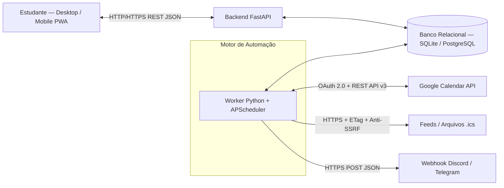

# UniFlow — Personal Academic Management

Aplicativo web instalável (**PWA**) e motor de automação em **Python** para centralizar a rotina acadêmica — disciplinas, tarefas, avaliações, eventos e lembretes — com sincronização bidirecional com o **Google Calendar**, importação automática de calendários **iCalendar (`.ics`)** e alertas automatizados.

---

## 1. Sobre o Projeto e Problema Resolvido

Na rotina universitária, informações críticas ficam fragmentadas entre o ambiente virtual de aprendizagem (LMS), calendários pessoais, grupos de mensagens e anotações soltas. Essa dispersão exige conferência manual diária e aumenta o risco de esquecer entregas ou conflitar horários de avaliações.

O **UniFlow** resolve essa dor centralizando toda a vida acadêmica em um banco relacional (**SQLite** em modo WAL localmente ou **PostgreSQL** em produção) e automatizando o que antes era repetitivo:

- **Sincronização bidirecional com o Google Calendar:** tarefas e eventos criados no UniFlow aparecem automaticamente no Google Calendar, e alterações feitas no Google voltam para o UniFlow de forma incremental (`syncToken`).
- **Importação de calendários acadêmicos (`.ics`):** consome feeds HTTPS ou arquivos `.ics` exportados pela instituição como eventos somente leitura, evitando duplicação por `UID` e respeitando cache HTTP (`ETag` / `If-Modified-Since`).
- **Detecção automática de prazos e alertas:** um worker dedicado avalia prazos críticos (24h antes, 2h antes e tarefas atrasadas), gera notificações sem duplicação na central interna e dispara alertas externos via Webhook (Discord/Telegram).

---

## 2. Arquitetura e Fluxo de Funcionamento

A aplicação separa a interface web (**React + TypeScript**) da API REST (**FastAPI**) e do **Worker de Automação** (**Python + APScheduler**). Essa separação impede que múltiplos workers HTTP executem agendamentos em duplicidade e permite que as automações rodem continuamente em segundo plano.



**Fluxo de dados (Gatilho → Processamento → Saída):**
1. **Gatilho (Trigger):** agendamento periódico via `APScheduler` (Google a cada 5 min, ICS a cada 30 min, prazos a cada 5 min) ou disparo manual pela interface/API.
2. **Processamento:** validação de payload com Pydantic, parsing de JSON (Google) e RFC 5545 (`.ics`), normalização de fusos horários (`America/Sao_Paulo` ↔ UTC), cálculo de hash SHA-256 para detectar alterações e regras condicionais (`if/else`) para evitar duplicações e classificar urgência de prazos.
3. **Saída (Action):** gravação no banco de dados, criação/atualização/remoção na Google Calendar API, geração de notificações deduplicadas, disparo de alertas via Webhook e registro auditável na tabela `sync_runs`.

---

## 3. Tecnologias e APIs Utilizadas

| Camada | Tecnologias / Protocolos | Papel no projeto |
|---|---|---|
| **Motor de Automação** | Python 3.11+, `APScheduler`, `httpx` | Rotinas agendadas, polling incremental e retentativas com backoff exponencial |
| **Backend & API** | `FastAPI`, `Pydantic v2`, `SQLAlchemy 2` | API REST JSON, validação de dados e persistência relacional |
| **Banco de Dados** | `SQLite` (WAL mode, zero config) / `PostgreSQL` | Fonte de verdade para entidades, mappings externos e logs de execução (`sync_runs`) |
| **Integrações de Rede** | Google Calendar API v3 (REST/HTTPS + OAuth 2.0), iCalendar (`.ics` / `icalendar`), Webhook HTTPS (Discord/Telegram) | Sincronização bidirecional, importação acadêmica somente leitura e envio de alertas |
| **Segurança** | `argon2-cffi`, `cryptography` (Fernet), cookies `HttpOnly` + CSRF, `.env` | Hash de senhas, criptografia de tokens OAuth/URLs ICS em repouso e proteção anti-SSRF |
| **Frontend (PWA)** | React 18, TypeScript, Vite, Tailwind CSS, Lucide Icons | Interface editorial minimalista responsiva para desktop e celular |
| **Testes** | `pytest` | Testes automatizados de segurança, anti-SSRF, idempotência ICS, deduplicação e resiliência |

---

## 4. Pré-requisitos e Como Executar

### Pré-requisitos
- **Python 3.11+** ([python.org](https://www.python.org/downloads/))
- **Node.js 18+** ([nodejs.org](https://nodejs.org/))
- *(Sem necessidade de Docker ou instalação manual de banco de dados.)*

### Execução rápida (1 comando)

1. **Clone ou extraia o repositório:**
   ```bash
   git clone https://github.com/SEU_USUARIO/uniflow.git
   cd uniflow
   ```

2. **Inicie tudo automaticamente:**
   - **Windows:** dê dois cliques em `iniciar.bat` (ou rode `python start.py` no terminal)
   - **Linux / macOS:** rode `./iniciar.sh` (ou `python3 start.py`)

   Na primeira execução, o inicializador cria automaticamente `backend/.env` com chaves seguras, monta o ambiente virtual `.venv`, instala as dependências Python e Node, cria o banco `backend/uniflow.db` com dados acadêmicos de demonstração e abre o navegador.

3. **Acesse a aplicação:**
   - **Frontend (PWA):** http://localhost:5173
   - **Documentação interativa da API (Swagger):** http://localhost:8000/docs
   - **Login inicial:** `estudante@uniflow.local` / **Senha:** `uniflow123`

4. ***(Opcional)* Ativar Google Calendar e Webhook de alertas:**
   Edite `backend/.env` preenchendo `GOOGLE_CLIENT_ID`, `GOOGLE_CLIENT_SECRET` (do Google Cloud Console, com URI de redirecionamento `http://localhost:8000/api/v1/integrations/google/callback`) e/ou `ALERT_WEBHOOK_URL` (Webhook do Discord) e reinicie o script.

5. **Executar os testes automatizados:**
   ```bash
   cd backend
   # Windows: .venv\Scripts\pytest -v
   # Linux/macOS: .venv/bin/pytest -v
   ```

---

## 5. Demonstração (Resultados)

> *Adicione aqui capturas de tela reais ou um GIF curto antes da entrega final.*

Sugestão de evidências para anexar nesta seção:
- **Dashboard do UniFlow:** visão "O que preciso fazer hoje?" com tarefas, prazos e status da sincronização.
- **Google Calendar sincronizado:** tarefa criada no UniFlow refletida automaticamente no Google Calendar e atualizada de volta após edição remota.
- **Importação ICS:** upload do arquivo `sample_academic_calendar.ics` gerando eventos somente leitura sem duplicatas.
- **Resiliência e Logs (`sync_runs`):** registro de execução bem-sucedida e captura controlada de erro HTTP 503 via botão **Simular falha (Demo)**.

Exemplo de saída real de uma execução registrada em `GET /api/v1/integrations/sync-runs`:

```json
{
  "id": "8cbfeb59-215c-4bf1-b13f-2ecb20c5cf7f",
  "provider": "google",
  "trigger": "manual",
  "status": "completed",
  "items_created": 2,
  "items_updated": 1,
  "items_deleted": 0,
  "items_unchanged": 14,
  "error_summary": null
}
```

---

## 6. Melhorias Futuras (Roadmap)

1. **Resolução visual de conflitos bidirecionais:** tela dedicada exibindo diff campo a campo quando um mesmo evento é editado simultaneamente no UniFlow e no Google Calendar.
2. **Fila de mutações offline via IndexedDB:** permitir criar e concluir tarefas mesmo sem conexão no celular, reconciliando automaticamente ao retornar online.
3. **Importação assistida de cronogramas em PDF:** extração estruturada de datas de provas e entregas a partir do plano de ensino da disciplina com revisão manual antes do cadastro.
